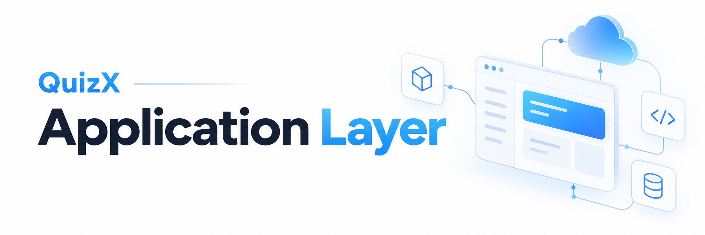
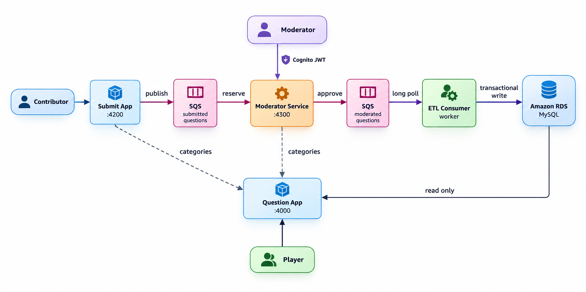

# QuizX application layer

QuizX is a community quiz platform built as four small, independently
deployable Node.js services. Anyone can propose a question, a moderator reviews
it, and only approved content reaches the database that players read from.

The application layer is designed for AWS. Services communicate through
**Amazon SQS**, quiz data lives in **Amazon RDS for MySQL**, and moderators
authenticate with **Amazon Cognito**. Each service ships as its own container
image.

## Architecture at a glance



| Service                         | Port | Responsibility                                                   | Talks to                   |
| ------------------------------- | ---: | ---------------------------------------------------------------- | -------------------------- |
| [`question-app`](question-app/) | 4000 | Serves the quiz UI and reads questions.                          | RDS (read)                 |
| [`submit-app`](submit-app/)     | 4200 | Validates proposed questions and queues them for review.         | SQS, Question App          |
| [`moderate`](moderate/)         | 4300 | Lets authorised moderators edit, approve, or reject submissions. | SQS, Cognito, Question App |
| [`etl-consumer`](etl-consumer/) |    – | Loads approved questions into the database.                      | SQS, RDS (write)           |

## Key design decisions

### 1. One writer to the database

Only the ETL Consumer can write to RDS. The Submit App and Moderator Service
have no database credentials, so a compromised public-facing service cannot
change the quiz catalogue. The Question App only ever reads.

**Trade-off:** a new question appears only after it has passed through two
queues and a worker. For moderated content, that delay is expected.

### 2. Queues instead of synchronous calls

Submission, moderation, and loading are separated by SQS queues:

- **Failures stay contained.** If RDS is down, submissions and moderation
  carry on. Approved questions wait in the queue until the worker catches up.
- **Each stage scales separately.** More ETL workers can be added without
  touching the web tier.
- **Durability comes from the platform.** SQS stores messages redundantly, so
  there is no broker to run, patch, or back up.

**Trade-off:** SQS standard queues deliver at least once and do not guarantee
order. Duplicate handling is covered in the next section.

### 3. Designed for at-least-once delivery

| Risk                                         | Mitigation                                                                                        |
| -------------------------------------------- | ------------------------------------------------------------------------------------------------- |
| Two moderators review the same submission.   | Receiving a message hides it (visibility timeout) for the review window.                          |
| A moderator takes longer than the timeout.   | The UI sends a heartbeat that extends visibility before it expires.                               |
| Approval succeeds but the delete fails.      | The approved message is sent _before_ the original is deleted, so content is never lost.          |
| The same approved message arrives twice.     | The ETL Consumer checks for duplicates inside the same transaction as the insert.                 |
| A message can never be processed.            | Validation failures are discarded; transient failures are made visible again at once and retried. |
| The worker crashes part-way through a write. | Category, question, and options are written in one database transaction.                          |

### 4. Stateless services

No service keeps session state on local disk or in memory:

- The moderator's reservation, including the SQS receipt handle, is carried in
  an **AES-256-GCM encrypted review token**, so any replica can handle the next
  request.
- Queue URLs are resolved from queue **names** at runtime, so configuration
  never contains an AWS account ID.
- The Submit App's category cache is only a fallback, so losing it does no
  harm.

The services can therefore run behind a load balancer and scale horizontally.

### 5. Defence in depth for privileged actions

- The Moderator Service verifies the Cognito access token and moderator group
  **itself**, even if API Gateway already checks the JWT. Authorisation still
  holds if the service is reached by another internal route.
- Strict security headers (CSP, `X-Frame-Options: DENY`, `no-referrer`), a
  32 KB request limit, and no `X-Powered-By` header.
- Errors returned to clients never include stack traces or internal details.
- Question content is not written to application logs.

## Security model

### IAM permissions (derived from the code)

Each service needs only the following permissions. Grant them through a
workload IAM role (for example EKS Pod Identity or IRSA) rather than static
keys.

| Service           | Resource                | Actions                                                                                           |
| ----------------- | ----------------------- | ------------------------------------------------------------------------------------------------- |
| Submit App        | Submitted queue         | `GetQueueUrl`, `SendMessage`, `GetQueueAttributes`                                                |
| Moderator Service | Submitted queue         | `GetQueueUrl`, `ReceiveMessage`, `ChangeMessageVisibility`, `DeleteMessage`, `GetQueueAttributes` |
| Moderator Service | Moderated queue         | `GetQueueUrl`, `SendMessage`, `GetQueueAttributes`                                                |
| ETL Consumer      | Moderated queue         | `GetQueueUrl`, `ReceiveMessage`, `ChangeMessageVisibility`, `DeleteMessage`                       |
| Question App      | None (no AWS API calls) | –                                                                                                 |

Database access is split the same way: the ETL Consumer needs `SELECT` and
`INSERT` on the quiz tables, and the Question App needs only `SELECT`.

### Secrets

- No credentials are stored in source control. `.env` files are git-ignored
  and excluded from Docker build contexts.
- AWS credentials come from the standard SDK credential chain.
- `DB_PASSWORD` and `REVIEW_TOKEN_SECRET` are injected at runtime from the
  platform's secret store.

## Operability

| Concern              | Implementation                                                                                 |
| -------------------- | ---------------------------------------------------------------------------------------------- |
| Health checks        | `/health` (liveness) is separate from `/ready` (readiness), which checks RDS or SQS.           |
| Graceful shutdown    | `SIGTERM` stops new work, lets in-flight requests finish, and closes pools and SDK clients.    |
| Fail-fast config     | Missing or invalid environment variables stop the process at startup.                          |
| Self-healing worker  | The ETL Consumer retries with a delay instead of crash-looping when RDS or SQS is unavailable. |
| Container hardening  | `node:24-alpine`, production dependencies only, non-root `node` user, Docker `HEALTHCHECK`.    |
| Graceful degradation | The Submit App serves cached categories if the Question App is down.                           |

## Well-Architected view

| Pillar                 | How the application layer supports it                                                         |
| ---------------------- | --------------------------------------------------------------------------------------------- |
| Operational excellence | Health and readiness endpoints, structured service READMEs, automated checks and tests in CI. |
| Security               | Single DB writer, least-privilege IAM, Cognito with group authorisation, encrypted tokens.    |
| Reliability            | Queue-based decoupling, at-least-once handling, transactional writes, delayed retries.        |
| Performance efficiency | Long polling, batched receives, a shared connection pool, one query for all answer options.   |
| Cost optimisation      | Managed queues instead of a self-hosted broker, small Alpine images, a scalable worker tier.  |
| Sustainability         | Long polling avoids empty receive calls; idle services do almost no work.                     |

## Known limitations and next steps

Listed openly, because they are the next decisions to make rather than
oversights:

- **Dead-letter queue:** a message that keeps failing for a non-validation
  reason is retried indefinitely. A DLQ with a redrive policy on the moderated
  queue would isolate it.
- **Idempotency key:** duplicates are detected by category and question text.
  Using the approved message `id` as a unique key would be stricter.
- **Rejection audit:** rejection reasons are returned but not stored. An audit
  table or queue would add a history.
- **Database credentials:** RDS IAM authentication or Secrets Manager rotation
  would replace a static password.
- **Random selection:** `ORDER BY RAND()` is fine at the current size but
  scans the category; a precomputed random key would scale further.
- **Moderator sign-in:** the UI accepts an existing Cognito access token. A
  Hosted UI authorisation-code flow is the planned replacement.

## Repository layout

```text
app/
├── question-app/    Read-only quiz API and player UI
│   ├── src/         Express server, config, RDS pool
│   └── public/      Browser assets
├── submit-app/      Submission API and form UI
│   ├── src/         Express server, SQS publisher, tests
│   └── public/
├── moderate/        Moderation API and moderator UI
│   ├── src/         Routes, auth, queue workflow, review tokens
│   ├── public/
│   └── test/        Unit tests (node:test)
└── etl-consumer/    SQS-to-RDS worker
    └── src/         Worker, config, RDS pool, tests
```

Each service has its own `README.md` covering its API, configuration, and
commands.

## Working on the services

From any service's package directory:

```bash
npm ci          # install exact dependency versions
npm run check   # syntax-check every source file
npm test        # run unit tests (where present)
npm start       # run locally, loading .env
```

Formatting is enforced in CI with Prettier.
