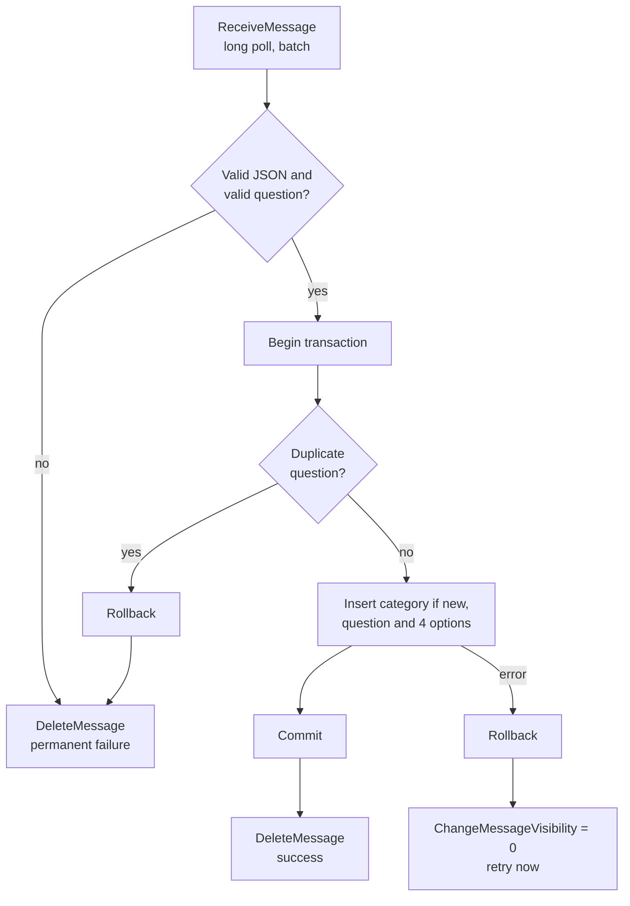

# QuizX ETL Consumer

A background worker and the **only component that writes quiz content to
Amazon RDS**. It long-polls the moderated-questions SQS queue, validates each
approved message, and stores it in a single database transaction.

Keeping writes in one small, non-public worker means the services exposed to
users never need write credentials for the database.

## Message lifecycle



## Processing guarantees

| Outcome                               | Action                        | Why                                                    |
| ------------------------------------- | ----------------------------- | ------------------------------------------------------ |
| Stored successfully                   | Delete the message.           | Work is complete.                                      |
| Invalid payload or duplicate question | Delete the message.           | Retrying cannot succeed, so it would block the queue.  |
| Database or network failure           | Make the message visible now. | Transient faults are retried instead of waiting 60 s.  |
| Worker crashes mid-message            | Nothing; SQS redelivers.      | The transaction rolls back, so no partial data exists. |

SQS standard queues deliver **at least once**, so the same approved message
may arrive twice. The duplicate check runs inside the same transaction as the
insert, which makes the write path safe to repeat.

## Design notes

- **Defence in depth.** Messages have already been approved, but the worker
  validates them again because it is the last check before the database.
- **Long polling and batching.** Up to `SQS_MAX_MESSAGES` messages per receive
  (capped at the SQS maximum of 10) with a 20-second wait. This keeps empty
  receives, and therefore cost, low.
- **Self-healing startup.** If RDS or SQS is unavailable, the worker logs the
  error, waits `RETRY_DELAY_MS`, and tries again instead of crash-looping.
- **Graceful shutdown.** On `SIGTERM` it stops polling and closes the SQS
  client and connection pool. Messages still in flight return to the queue
  when their visibility timeout ends.
- **Horizontal scaling.** Workers share nothing, so more replicas can be added
  to drain a backlog; queue depth is a natural autoscaling signal.

## Approved message contract

Produced by the Moderator Service:

```json
{
  "schemaVersion": 4,
  "id": "submission-id",
  "category": "Science",
  "question": "What is the chemical symbol for gold?",
  "options": ["Au", "Ag", "Fe", "Pb"],
  "answer": "Au",
  "moderation": {
    "status": "approved",
    "moderatedAt": "2026-01-01T12:00:00.000Z",
    "moderator": { "subject": "…", "username": "…" },
    "sourceMessageId": "…"
  }
}
```

## Configuration

| Variable                         | Required | Default     | Description                                       |
| -------------------------------- | -------- | ----------- | ------------------------------------------------- |
| `AWS_REGION`                     | No       | `eu-west-2` | AWS region.                                       |
| `MODERATED_QUESTIONS_QUEUE_NAME` | Yes      | –           | Queue containing approved questions.              |
| `SQS_MAX_MESSAGES`               | No       | `5`         | Messages per receive (SQS maximum is 10).         |
| `SQS_WAIT_TIME_SECONDS`          | No       | `20`        | Long-poll duration (SQS maximum is 20).           |
| `SQS_VISIBILITY_TIMEOUT_SECONDS` | No       | `60`        | Time a message stays hidden while processing.     |
| `RETRY_DELAY_MS`                 | No       | `5000`      | Pause before reconnecting after an RDS/SQS error. |
| `DB_HOST`                        | Yes      | –           | RDS endpoint, without a URL scheme.               |
| `DB_PORT`                        | No       | `3306`      | RDS MySQL port.                                   |
| `DB_USER`                        | Yes      | –           | Database user with `SELECT` and `INSERT` rights.  |
| `DB_PASSWORD`                    | Yes      | –           | Injected at runtime; never committed.             |
| `DB_NAME`                        | Yes      | –           | QuizX database name.                              |

### IAM permissions

On the moderated-questions queue only: `sqs:GetQueueUrl`,
`sqs:ReceiveMessage`, `sqs:DeleteMessage`, `sqs:ChangeMessageVisibility`.

## Next steps

- Attach a **dead-letter queue** with a redrive policy so a message that keeps
  failing for a non-validation reason is set aside after N attempts.
- Enforce idempotency with a unique key on the approved message `id`, in
  addition to the current question-text check.

## Source files

| File                   | Responsibility                                           |
| ---------------------- | -------------------------------------------------------- |
| `src/consumer.js`      | Polling loop, validation, transactional write, shutdown. |
| `src/config.js`        | Reads and validates environment variables.               |
| `src/db.js`            | Shared MySQL connection pool.                            |
| `src/sqs.js`           | Resolves a queue name to its URL.                        |
| `src/test/sqs.test.js` | Unit tests for queue URL resolution.                     |

## Commands

Run from `app/etl-consumer/src`:

```bash
npm ci
npm run check
npm test
npm start
```

## Container image

```bash
docker build -t quizx-etl-consumer:4.0.0 app/etl-consumer
```

The image contains only the worker and runs as the non-root `node` user. SQS
and RDS stay external managed services.
