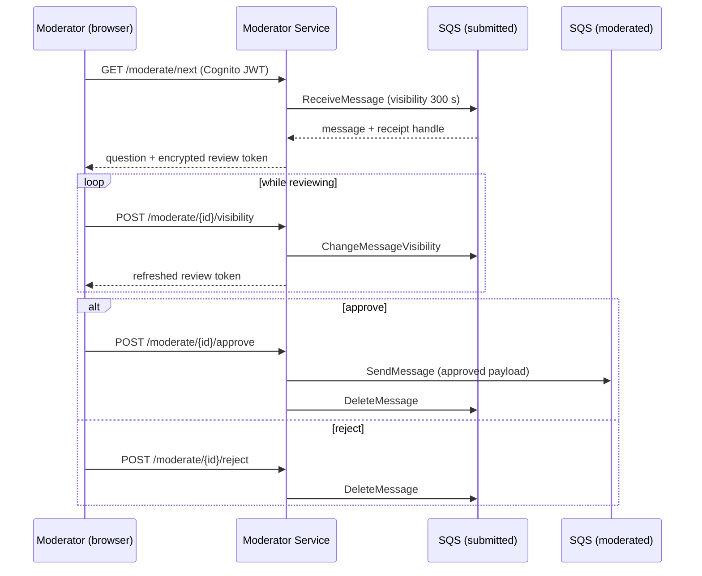

# QuizX Moderator Service

The **trust boundary** between user-submitted content and the quiz database.
Authenticated moderators reserve one submission at a time from SQS, correct it
if needed, and approve or reject it. Only approved questions are forwarded to
the queue that feeds the database.

The service is stateless and keeps no database connection. All of its state
lives in SQS and in encrypted tokens held by the browser.

## Review workflow



## Design decisions

### Reservations use SQS visibility, not a lock table

Receiving a message hides it from other consumers for the visibility timeout
(300 seconds by default), which is how SQS stops two moderators from reviewing
the same question. No extra database or lock service is needed. While the
moderator works, the UI sends a heartbeat 30 seconds before the reservation
would expire. If the browser is closed, the message simply becomes visible
again for someone else.

### Encrypted review tokens keep the service stateless

To approve or reject, the service needs the SQS receipt handle from the
original receive. Instead of storing it server-side, the service seals it in a
**review token** using AES-256-GCM with the shared `REVIEW_TOKEN_SECRET`:

- The browser cannot read or alter the receipt handle; any tampering fails
  authentication.
- The token expires with the visibility timeout.
- Any replica can verify any token, so the service scales horizontally
  without sticky sessions.

### Send before delete

Approval publishes to the moderated queue **before** deleting the original
submission. If the service fails between the two calls, the worst case is a
duplicate, which the ETL Consumer detects. The alternative order could lose an
approved question. When the moderated queue is FIFO, the source message ID is
used as the deduplication ID.

### Authorisation is enforced inside the service

Every moderation route verifies the Cognito **access token** (signature,
expiry, client ID) and requires membership of the moderator group, using
`aws-jwt-verify`. This still applies if API Gateway also validates the JWT,
so the boundary holds even when the service is reached through another
internal route.

There is no switch to turn authentication off. The service will not start
without a Cognito user pool and client ID, so a missing setting can never
leave the moderation API open.

### Hardened HTTP surface

- Content-Security-Policy, `X-Frame-Options: DENY`, `nosniff`, and
  `Referrer-Policy: no-referrer` on every response.
- `Cache-Control: no-store` on moderation responses.
- A 32 KB request body limit and length limits on all question fields.
- Consistent JSON errors with stable `code` values; unexpected errors return a
  generic message and are logged without bodies or tokens.
- The access token is kept in `sessionStorage` for the current tab only and is
  never logged by the service.

## HTTP API

| Method | Path                        | Auth          | Purpose                                         |
| ------ | --------------------------- | ------------- | ----------------------------------------------- |
| `GET`  | `/moderate`                 | –             | Moderator web UI.                               |
| `GET`  | `/moderate/config`          | –             | Non-sensitive UI settings (group, timings).     |
| `GET`  | `/moderate/next`            | Moderator JWT | Reserve the next submission (`204` if empty).   |
| `PUT`  | `/moderate/{id}`            | Moderator JWT | Validate edits without publishing.              |
| `POST` | `/moderate/{id}/approve`    | Moderator JWT | Publish downstream, then remove the submission. |
| `POST` | `/moderate/{id}/reject`     | Moderator JWT | Remove without forwarding.                      |
| `POST` | `/moderate/{id}/visibility` | Moderator JWT | Extend the reservation and refresh the token.   |
| `GET`  | `/moderate/categories`      | Moderator JWT | Existing categories from the Question App.      |
| `GET`  | `/moderate/docs`            | Moderator JWT | Machine-readable API summary.                   |
| `GET`  | `/health`                   | –             | Liveness.                                       |
| `GET`  | `/ready`                    | –             | Readiness: both SQS queues are reachable.       |

| Status | Code                           | Meaning                                       |
| -----: | ------------------------------ | --------------------------------------------- |
|  `400` | `VALIDATION_ERROR`             | The edited question breaks a rule.            |
|  `401` | `UNAUTHENTICATED`              | Missing, invalid, or expired access token.    |
|  `403` | `FORBIDDEN`                    | Valid token but not in the moderator group.   |
|  `409` | `INVALID_REVIEW_TOKEN`         | The reservation expired or was tampered with. |
|  `503` | `QUEUE_UNAVAILABLE`            | SQS cannot be reached.                        |
|  `503` | `CATEGORY_SERVICE_UNAVAILABLE` | The Question App cannot be reached.           |

## Message contracts

**Input** (submitted queue, produced by the Submit App). The same JSON wrapped
in an SNS `Message` field is also accepted, so an SNS fan-out can be added
later without code changes.

```json
{
  "question": "What is the chemical symbol for gold?",
  "options": ["Au", "Ag", "Fe", "Pb"],
  "answer": "Au",
  "category": "Science",
  "newCategory": "",
  "finalCategory": "Science"
}
```

**Output** (moderated queue, consumed by the ETL Consumer): `schemaVersion: 4`,
a stable `id`, the normalised question, and `moderation` metadata recording
the moderator, time, and source message ID. The full shape is documented in
the [ETL Consumer README](../etl-consumer/README.md#approved-message-contract).

## Configuration

| Variable                           | Required | Default            | Description                                  |
| ---------------------------------- | -------- | ------------------ | -------------------------------------------- |
| `PORT`                             | No       | `4300`             | HTTP port.                                   |
| `AWS_REGION`                       | No       | `eu-west-2`        | AWS region.                                  |
| `SUBMITTED_QUESTIONS_QUEUE_NAME`   | Yes      | –                  | Queue the service reviews from.              |
| `MODERATED_QUESTIONS_QUEUE_NAME`   | Yes      | –                  | Queue approved questions are sent to.        |
| `QUEUE_WAIT_TIME_SECONDS`          | No       | `20`               | Long-poll duration (0–20).                   |
| `QUEUE_VISIBILITY_TIMEOUT_SECONDS` | No       | `300`              | Reservation length (30–43200).               |
| `REVIEW_TOKEN_SECRET`              | Yes      | –                  | At least 32 characters, from a secret store. |
| `COGNITO_USER_POOL_ID`             | Yes      | –                  | User pool that issues moderator tokens.      |
| `COGNITO_CLIENT_ID`                | Yes      | –                  | App client the tokens must be issued for.    |
| `COGNITO_MODERATOR_GROUP`          | No       | `quizx-moderators` | Group required for moderation.               |
| `QUESTION_APP_BASE_URL`            | Yes      | –                  | Where categories are read from.              |
| `CATEGORY_REQUEST_TIMEOUT_MS`      | No       | `3000`             | Timeout for the category call.               |

Missing required values stop the service at startup. Queue URLs are resolved
from the names at startup too, so a wrong name or a missing permission stops
the service before it accepts traffic.

In a deployed container, the orchestrator injects these values. To run the
service outside a container, copy `.env.example` to `.env`, fill it in against
a development AWS environment, and use `npm start`.

### IAM permissions

| Queue     | Actions                                                                                                               |
| --------- | --------------------------------------------------------------------------------------------------------------------- |
| Submitted | `sqs:GetQueueUrl`, `sqs:ReceiveMessage`, `sqs:ChangeMessageVisibility`, `sqs:DeleteMessage`, `sqs:GetQueueAttributes` |
| Moderated | `sqs:GetQueueUrl`, `sqs:SendMessage`, `sqs:GetQueueAttributes`                                                        |

Use a workload IAM role (EKS Pod Identity or IRSA) rather than static keys.

## Known limitations

- Rejection reasons are returned to the caller but not stored. An audit table
  or queue would provide a durable history.
- The UI accepts an existing Cognito access token. A Hosted UI
  authorisation-code flow is planned once the callback domain is fixed.

## Source files

| File                  | Responsibility                                             |
| --------------------- | ---------------------------------------------------------- |
| `src/server.js`       | Validates configuration, wires dependencies, starts/stops. |
| `src/app.js`          | Routes, security headers, and error mapping.               |
| `src/auth.js`         | Cognito JWT verification and group authorisation.          |
| `src/queue.js`        | Reserve, extend, approve, and reject using SQS.            |
| `src/review-token.js` | AES-256-GCM sealing and verification of reservations.      |
| `src/question.js`     | Normalisation and validation of the question contract.     |
| `src/categories.js`   | Category lookup from the Question App with a timeout.      |
| `src/config.js`       | Environment parsing with range checks.                     |
| `src/errors.js`       | Typed errors with HTTP status and stable error codes.      |
| `public/`             | Moderator UI (HTML, JavaScript, CSS).                      |
| `test/`               | Unit tests for queue, token, question, and category logic. |

The SQS client, clock, and `fetch` are injected into `ModerationQueue`, the
review-token manager, and the category client, so the tests run against fakes
without calling AWS.

## Commands

Run from `app/moderate`:

```bash
npm ci
npm run check
npm test
npm start
```

## Container image

```bash
docker build -t quizx-moderate:4.0.0 app/moderate
```

The image runs as the non-root `node` user, excludes tests and `.env` files,
and includes a `HEALTHCHECK`. Amazon SQS and Amazon Cognito stay external
managed services.
