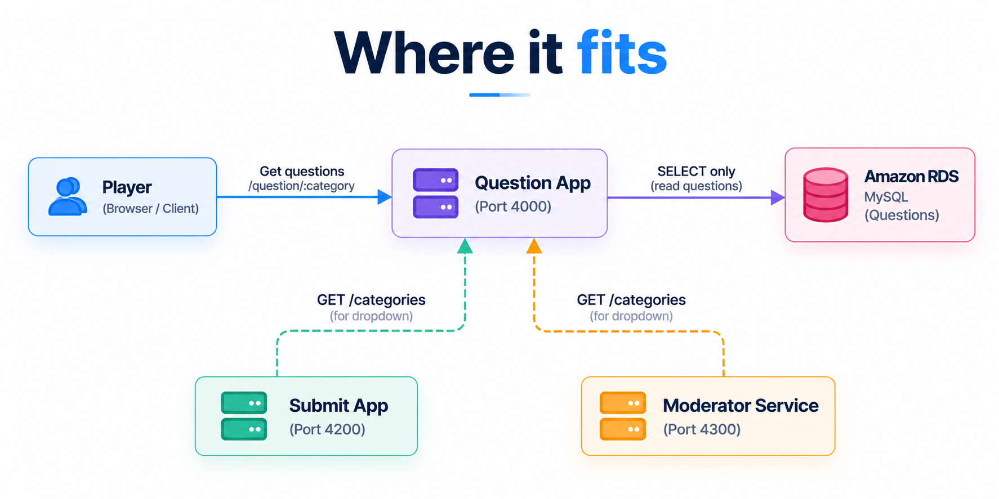

# QuizX Question App

The read side of QuizX. It serves the player-facing quiz and reads categories,
questions, and answer options from Amazon RDS for MySQL. It never creates,
edits, or moderates content, so it can be scaled and cached independently of
the write path.

## Where it fits



The Question App is also the single source of truth for **category names**.
The Submit App and Moderator Service call it instead of querying the database
themselves, so neither of them needs database credentials.

## Design notes

- **Read-only by design.** The service needs only `SELECT` on the quiz tables.
  Running it with a read-only database user limits the damage if it is ever
  compromised.
- **Health and readiness are separate.** `/health` answers as long as the
  process is running; `/ready` also checks RDS. A load balancer or Kubernetes
  can then restart a dead process without restarting healthy ones during a
  database incident.
- **Efficient queries.** One query picks random questions and a second loads
  all their options with an `IN (...)` clause, which avoids an N+1 query
  pattern.
- **Bounded responses.** `MAX_QUESTION_COUNT` caps each response, so a client
  cannot request an unbounded result set.
- **Fair answer order.** Options are shuffled (Fisher-Yates) on every request,
  so the correct answer is not always in the same position.
- **Path-prefix routing.** Every route is also available under `/question/...`,
  so the service can sit behind a shared load balancer or API Gateway that
  routes on path.

**Trade-off:** the correct answer is sent to the browser so it can give
instant feedback. That suits a casual quiz; a graded exam would check answers
on the server instead.

## HTTP API

| Method | Path                          | Purpose                                         |
| ------ | ----------------------------- | ----------------------------------------------- |
| `GET`  | `/health`                     | Liveness: the Node.js process is running.       |
| `GET`  | `/ready`                      | Readiness: the service can query RDS.           |
| `GET`  | `/db/health`                  | Alias for `/ready`.                             |
| `GET`  | `/categories`                 | All category names, sorted.                     |
| `GET`  | `/question/:category?count=5` | Random questions from one category.             |
| `GET`  | `/questions/:category`        | Alias for `/question/:category`.                |
| `GET`  | `/docs`                       | Machine-readable summary of the API and limits. |
| `GET`  | `/question`                   | The browser interface.                          |

## Configuration

| Variable             | Required | Default | Description                                |
| -------------------- | -------- | ------- | ------------------------------------------ |
| `PORT`               | No       | `4000`  | HTTP port.                                 |
| `MAX_QUESTION_COUNT` | No       | `25`    | Maximum questions returned by one request. |
| `DB_HOST`            | Yes      | –       | RDS endpoint, without a URL scheme.        |
| `DB_PORT`            | No       | `3306`  | RDS MySQL port.                            |
| `DB_USER`            | Yes      | –       | Database user (read-only is sufficient).   |
| `DB_PASSWORD`        | Yes      | –       | Injected at runtime; never committed.      |
| `DB_NAME`            | Yes      | –       | QuizX database name.                       |

Missing or invalid values stop the service at startup.

## Source files

| File                | Responsibility                                            |
| ------------------- | --------------------------------------------------------- |
| `src/server.js`     | Routes, queries, error handling, and graceful shutdown.   |
| `src/config.js`     | Reads and validates environment variables.                |
| `src/db.js`         | Shared MySQL connection pool with keep-alive.             |
| `public/index.html` | Quiz page markup.                                         |
| `public/app.js`     | Loads categories and questions; handles answer selection. |
| `public/style.css`  | Responsive styling.                                       |

## Commands

Run from `app/question-app/src`:

```bash
npm ci
npm run check
npm start
```

## Container image

```bash
docker build -t quizx-question-app:4.0.0 app/question-app
```

The image is based on `node:24-alpine`, installs production dependencies only,
runs as the non-root `node` user, and includes a Docker `HEALTHCHECK` against
`/health`. RDS stays an external managed service.
