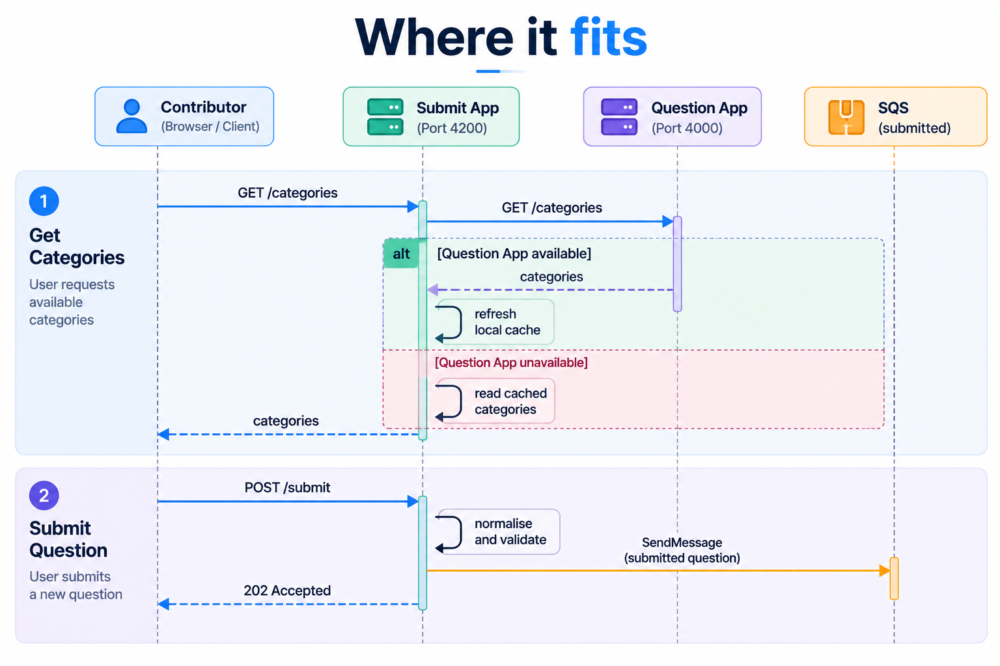

# QuizX Submit App

The public entry point for new content. It accepts proposed quiz questions,
validates them, and publishes them to Amazon SQS for moderation. It has **no
database access**, so nothing a user submits can reach RDS without a
moderator's approval.

## Where it fits



## Design notes

- **Asynchronous by design.** `POST /submit` returns `202 Accepted`: the
  question is queued, not published. That is honest about the workflow and
  keeps response times independent of moderation and the database.
- **Validation at the edge, repeated downstream.** Bad input is rejected here
  with a clear message. The ETL Consumer validates every message again before
  writing, so the database never relies on a single check.
- **Graceful degradation.** The last good category list is cached on disk. If
  the Question App is unavailable, users can still submit questions against
  the cached categories.
- **Lazy AWS initialisation.** The SQS client and queue URL are created on
  first use, so the web server starts even if AWS is briefly unreachable.
  `/ready` reports when the queue is actually available. A failed URL lookup
  is not cached, so the next request retries it.
- **No account IDs in config.** Only the queue _name_ is configured; the URL
  is resolved with `GetQueueUrl`.
- **Privacy-aware logging.** Logs record that a question was queued and its
  category, never the question text.

## HTTP API

| Method | Path            | Purpose                                                         |
| ------ | --------------- | --------------------------------------------------------------- |
| `GET`  | `/health`       | Liveness: the Node.js process is running.                       |
| `GET`  | `/ready`        | Readiness: the submitted-questions queue is reachable.          |
| `GET`  | `/queue/health` | Alias for `/ready`.                                             |
| `GET`  | `/categories`   | Categories from the Question App, or from cache if unavailable. |
| `POST` | `/submit`       | Validates one question and queues it for moderation.            |
| `GET`  | `/docs`         | Machine-readable summary of the API and payload.                |
| `GET`  | `/submit`       | The browser interface.                                          |

### Submission contract

```json
{
  "category": "Science",
  "newCategory": "",
  "question": "What is the chemical symbol for gold?",
  "options": ["Au", "Ag", "Fe", "Pb"],
  "answer": "Au"
}
```

Rules:

- Exactly one of `category` or `newCategory` is set.
- There are exactly four non-empty options, unique regardless of case.
- `answer` matches one of the options exactly.

## Configuration

| Variable                         | Required | Default                             | Description                              |
| -------------------------------- | -------- | ----------------------------------- | ---------------------------------------- |
| `PORT`                           | No       | `4200`                              | HTTP port.                               |
| `QUESTION_APP_BASE_URL`          | Yes      | –                                   | Base URL of the Question App.            |
| `CATEGORY_CACHE_FILE`            | No       | `/var/lib/category/categories.json` | Where the last category list is cached.  |
| `AWS_REGION`                     | No       | `eu-west-2`                         | AWS region.                              |
| `SUBMITTED_QUESTIONS_QUEUE_NAME` | Yes      | –                                   | SQS queue that receives new submissions. |

AWS credentials come from the standard SDK credential chain (a workload IAM
role in production).

### IAM permissions

On the submitted-questions queue only: `sqs:GetQueueUrl`, `sqs:SendMessage`,
`sqs:GetQueueAttributes`.

## Source files

| File                   | Responsibility                                                |
| ---------------------- | ------------------------------------------------------------- |
| `src/server.js`        | Routes, validation, category cache, error handling, shutdown. |
| `src/queue.js`         | SQS publishing and readiness checks.                          |
| `src/sqs.js`           | Resolves a queue name to its URL.                             |
| `src/config.js`        | Reads and validates environment variables.                    |
| `src/test/sqs.test.js` | Unit tests for queue URL resolution.                          |
| `public/`              | Submission form (HTML, JavaScript, CSS).                      |

## Commands

Run from `app/submit-app/src`:

```bash
npm ci
npm run check
npm test
npm start
```

## Container image

```bash
docker build -t quizx-submit-app:4.0.0 app/submit-app
```

The image runs as the non-root `node` user, includes a `HEALTHCHECK`, and
creates a writable directory for the category cache. Amazon SQS stays an
external managed service.
