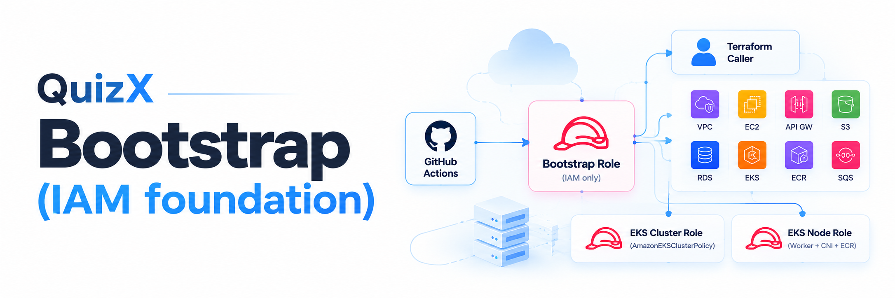
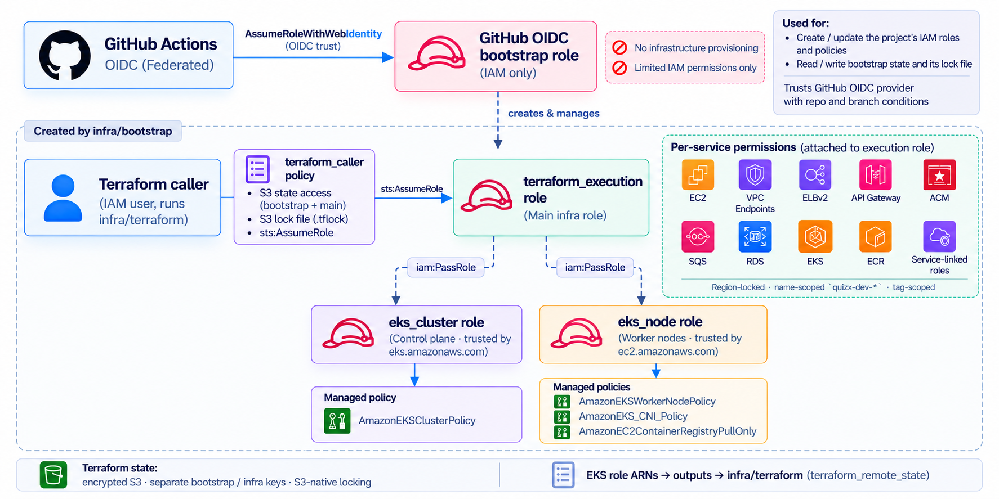

# QuizX bootstrap (IAM foundation)

This Terraform stack runs **once per account and environment, before any other
infrastructure**. It creates the IAM identities and least-privilege policies
that the main stack ([`infra/terraform`](../terraform/)) and the EKS cluster
depend on.

Splitting bootstrap from the main stack separates two very different levels of
privilege:

| Stack             | Who runs it                      | What it can change                               |
| ----------------- | -------------------------------- | ------------------------------------------------ |
| `infra/bootstrap` | A tightly scoped bootstrap role  | IAM roles and policies for the project           |
| `infra/terraform` | The Terraform **execution role** | Platform resources (VPC, ALB, EKS, RDS, SQS ...) |

The main stack never holds IAM-write permissions for its own role. It can only
do what bootstrap granted it.

## What it creates



The EKS role ARNs are exported as outputs and read by `infra/terraform`
through `terraform_remote_state`.

## Least-privilege design

Every execution policy combines several of these guardrails:

| Guardrail                 | Mechanism                                                                                                                     |
| ------------------------- | ----------------------------------------------------------------------------------------------------------------------------- |
| Region lock               | `aws:RequestedRegion` / `ec2:Region` must equal the deployment region.                                                        |
| Name scope                | ARNs limited to `<project>-<environment>-*` (SQS, ECR, EKS).                                                                  |
| Tag scope                 | Where supported (SQS, ACM, security groups), create calls require and manage calls check `Project`/`Environment`/`ManagedBy`. |
| Controlled `iam:PassRole` | Only the two bootstrap EKS roles, and only to `eks` or `ec2`.                                                                 |
| Service-linked roles      | `iam:CreateServiceLinkedRole` only for the ELB, API Gateway, RDS, and EKS services.                                           |
| Exact state objects       | The caller can read and write only the bootstrap and main state objects and their lock files.                                 |
| No message access         | The execution role manages queue lifecycle only; it cannot send or read messages.                                             |

Policies are split per service so each one is small enough to review on its
own and stays within IAM's managed-policy size limit.

## Files

| File                                      | Purpose                                                          |
| ----------------------------------------- | ---------------------------------------------------------------- |
| `main.tf`                                 | Encrypted S3 backend (settings supplied at init).                |
| `terraform.tf`                            | Terraform and AWS provider versions, provider with default tags. |
| `variables.tf`                            | Inputs, grouped by purpose, with validation.                     |
| `locals.tf`                               | Naming prefix, standard tags, derived values.                    |
| `iam-roles.tf`                            | The three IAM roles and their trust policies.                    |
| `iam-policies.tf`                         | Managed policies and their attachments.                          |
| `iam-policy-document.tf`                  | The policy JSON, kept separate for easy review.                  |
| `outputs.tf`                              | EKS role ARNs for the main stack.                                |
| `terraform.tfvars.example`                | Template for the git-ignored `terraform.tfvars`.                 |
| `backend.hcl.example`                     | Template for the git-ignored `backend.hcl`.                      |
| `bootstrap-principal-policy.json.example` | Example permissions for the identity that runs bootstrap.        |

## Running it

### GitHub Actions (normal path)

Bootstrap runs as the **first stage of the CD pipeline** (`cd.yml`), before
the `infra/terraform` stage that depends on the roles it creates.

The stage authenticates to AWS with **GitHub OIDC**: the job exchanges a
short-lived GitHub token for temporary credentials on a dedicated bootstrap
role, so no long-lived access keys are stored in GitHub. That role can only
manage this stack's IAM resources and state; it cannot provision
infrastructure itself.

Inputs come from repository secrets and are passed as `TF_VAR_*` variables.

### From a workstation

```bash
cd infra/bootstrap
cp backend.hcl.example backend.hcl            # fill in the state bucket
cp terraform.tfvars.example terraform.tfvars  # fill in account and names
terraform init -backend-config=backend.hcl
terraform plan
terraform apply
```

`backend.hcl` and `terraform.tfvars` are git-ignored. Commit only the
`.example` templates.

## Order of operations

**Deploy**

1. Create the S3 state bucket (versioned and encrypted) and the OIDC bootstrap
   role. These are the only manual prerequisites.
2. Apply **this stack**.
3. Apply `infra/terraform`, which assumes the execution role created here.

**Teardown** runs in reverse: destroy `infra/terraform` first, then this
stack. Bootstrap must go last because the platform depends on its roles. For
example, an EKS managed node group attaches the node role to an instance
profile, and IAM will not delete the role while that node group exists.

## Notes for reviewers

- Bootstrap itself runs through GitHub OIDC. The execution role still trusts
  the Terraform IAM user, and the caller policy is attached to that user,
  because `infra/terraform` is still run by that user. The next step is a
  separate OIDC deploy role, after which the user can be retired.
- State uses S3-native locking (`use_lockfile`), so concurrent runs cannot
  corrupt it and no DynamoDB lock table is needed.
- Runtime access for the services (SQS) is intentionally not defined here. It
  belongs with the EKS workload identity (Pod Identity or IRSA), which can only
  be trusted once the cluster exists.
- A `moved` block in `iam-policies.tf` records a resource rename so the
  existing policy is moved in state rather than replaced.
